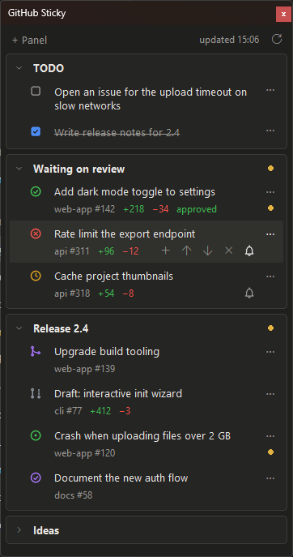

# gh-sticky

A small always-on-top window that keeps hand-picked GitHub pull requests and
issues in front of you, grouped in panels, styled after the Changes list in the
Claude desktop app.

<!-- A table rather than : the float is ignored by some
     previews (VS Code); a table lays out the same everywhere. -->
<table>
<tr>
<td valign="top">

- Panels are created, renamed and reordered inline (hover a panel title for its
  actions, double-click it to rename).
- Items are added by hand: paste one or more PR/issue links (or
  `owner/repo#123`) into a panel's add box. No filters or searches.
- Anything else typed into the add box becomes a note: a local reminder with a
  checkbox, for things that have no issue or PR yet (a "TODO" panel moved to
  the top works well). Double-click a note to edit it; "Link to PR/issue…" in
  its menu turns it into the tracked item once one exists, and "Clear done
  notes" in the panel menu removes the ticked ones.
- Each item shows its title, `repo #number`, `+additions −deletions` and the
  review decision (approved / changes requested) for open PRs, and an icon for
  its state: CI result for open PRs (passed, failed, running), draft, merged,
  closed, or the issue state.
- A yellow dot marks new activity since you last opened the item: a comment or
  review by someone else (not you, not a bot), a state or review change, or a
  newer unread GitHub notification. Opening the item (or "Mark as read")
  clears it.
- A bell shows on items you're not subscribed to; click it to subscribe. That
  turns on GitHub notifications for that PR or issue, on the web and by email,
  depending on your GitHub notification settings. On subscribed items, hover
  to get the crossed-out bell to unsubscribe.
- Click an item to open it in the browser. Hover it to add more items, move it
  up or down, or remove it; right-click or `⋯` also copies its URL or moves it
  to another panel.
- Refreshes every 5 minutes (or with the refresh button) through one
  `gh api graphql` call.

</td>
<td valign="top" width="45%">

</td>
</tr>
</table>

## Requirements

- Python 3.9+ with tkinter (included on Windows and in the python.org macOS
  installer; on Linux install `python3-tk` or your distribution's equivalent).
- [GitHub CLI](https://cli.github.com/) installed and logged in
  (`gh auth login`). The tool stores no tokens; it only calls `gh`.
- For the bell (subscribe / unsubscribe), gh's token also needs the
  `notifications` scope, which the default login doesn't include. Add it once:

  ```bash
  gh auth refresh -s notifications
  ```

  Without it everything else works; the bell shows this hint when clicked.
  Notification-based dots need a classic token (gh's default); fine-grained
  tokens can't read notifications, so the dot then relies on activity only.

No other packages.

## Run

```bash
# Windows, without a console window
pythonw gh-sticky.pyw
# Linux / macOS
python3 gh-sticky.pyw
# Use another state file, e.g. one per project or a synced folder
python3 gh-sticky.pyw --state ~/Dropbox/gh-sticky.json
```

## State

Panels, items, the last fetched data and the window geometry are saved to the
file given with `--state`, or by default to:

| OS | Path |
|---|---|
| Windows | `%APPDATA%\gh-sticky\state.json` |
| macOS | `~/Library/Application Support/gh-sticky/state.json` |
| Linux | `$XDG_CONFIG_HOME/gh-sticky/state.json` (default `~/.config/...`) |

## Platform notes

Developed and tested on Windows 11. Linux and macOS use fallbacks (default
font, plain-text button glyphs, X11 wheel buttons, Button-2 right click on
macOS) but have not been tried yet. On Wayland, the compositor may ignore
always-on-top.
